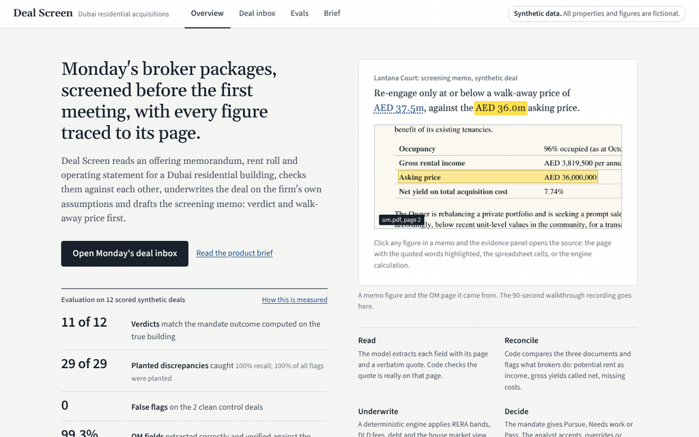

# Deal Screen

**A first-pass screen for acquiring income-producing residential buildings in Dubai.** Give it a broker's package (offering memorandum, rent roll, operating statement) and it reconciles the three documents, underwrites the deal on the firm's own assumptions, tests it against the firm's mandate, and drafts the screening memo: verdict and walk-away price first, every number traced to a page, a cell or a calculation.

**[Open the live demo](https://ryanfuruness.github.io/property-acquisition-deal-screen/)** · [Product brief](docs/BRIEF.md) · [Eval report](evals/REPORT.md)



*All deals in this repository are synthetic: the buildings, brokers, tenants and figures are fictional, generated with known answers so the screen can be measured.*

## Results

Twelve synthetic broker packages, with discrepancies planted the way brokers plant them, scored by an [independent eval harness](evals/README.md) against ground truth:

| Measure | Result |
|---|---|
| Planted discrepancies caught | **29 of 29** (100%) |
| Flags raised that were planted | **29 of 29**: no false flags, none on the two clean deals |
| Verdicts matching the true building | **11 of 12** |
| OM fields extracted correctly | 297 of 297; 295 also verified against the page by code |
| Rent-roll units parsed | 1,149 of 1,149, no summary rows counted as units |
| Underwriting vs the true building | Year-1 NOI and walk-away price within 0.1% on average |
| Memo numbers traced to a fact | 835 of 835; every memo passed the check |
| Cost and time per deal | USD 0.45, about 95 seconds, against 20 to 45 minutes of re-keying by hand |

Every miss, its cause and its fix is in the [failure log](evals/FAILURES.md); the remaining misses are deliberate design choices or a genuinely ambiguous cost line, explained there.

## What it catches

Broker packages flatter the deal, and Dubai in late 2026 makes the gap expensive: rents are falling in the main mid-market areas, RERA's index bands cap how far an under-rented unit can rise at renewal, and a single-title building's owner carries costs that broker yields leave out. The screen checks sixteen kinds of discrepancy, among them:

- **Occupancy and income that do not tie to the rent roll:** an undated "97% occupied" against 90% in the rent roll; "annual rental income" that includes vacant units at asking rent.
- **Yields on the wrong basis:** "net" yields that deduct almost nothing, quoted on asking price without the 4% DLD fee.
- **Upside the law does not allow:** reversion claims beyond what RERA's bands permit at renewal, and income let above today's market that will reset down.
- **Costs that are missing:** district cooling in a chiller-free building, management, insurance, reserves; nine months of costs annualised as a year.
- **Rent rolls that do not foot:** stale totals, holding-over tenants counted as occupied, missing Ejari numbers, areas in square metres.
- **Structure and title:** income from a master lease to the seller's affiliate; strata buildings sold as single-owner; plots whose tenure is never stated.

## How it works

```
broker package ──► read ──► verify ──► reconcile ──► underwrite ──► mandate fit ──► memo ──► check
                  model      code     code + model      code           code        model     code
```

- **The model reads; code computes and verifies.** The model extracts each field with its page and a verbatim quote, maps messy rent-roll and statement layouts, and reviews the OM's language. Code checks every quote is really on its page (OCR for scanned pages), parses every rent-roll row, and runs all arithmetic in a [deterministic underwriting engine](engine/README.md). A memo containing any number that does not match a fact fails and is not shipped.
- **The firm's view is data.** The buy box, underwriting assumptions, house market view and Dubai rules (DLD fees, RERA bands, VAT, corporate tax) live in [`data/mandate.yaml`](data/mandate.yaml), with sources in [`docs/research`](docs/research).
- **The walk-away price answers the question an investment committee asks first:** the most the firm should pay, solved against the return target and the lender's coverage floor.
- **Unknowns count against a deal.** The screen never decides title or other legal questions; it blocks on them and says what to check.

Design detail: [`docs/DESIGN.md`](docs/DESIGN.md). Pipeline and run-record schema: [`pipeline/README.md`](pipeline/README.md).

## Run it

Python 3.11+.

```bash
pip install anthropic pdfplumber pymupdf openpyxl pytesseract pyyaml   # plus the tesseract binary for scanned pages
python -m pytest                                    # engine, pipeline and eval tests (no API calls)
python -m engine tests/engine/fixtures/jvc_60_units.json    # underwrite a deal without any model

export ANTHROPIC_API_KEY=...                        # or ANTHROPIC_API_KEY_FILE=/path/to/key
python -m pipeline run d03-sorrel-jvc               # screen one package (about USD 0.50, under two minutes)
python -m evals score --label my-run                # score runs/ against ground truth
python tools/generate_deals.py                      # rebuild the synthetic deal set (deterministic)
python tools/build_site_data.py                     # refresh the demo site's data
```

## Repository

| Path | What it is |
|---|---|
| `data/deals/` | Twelve synthetic broker packages and their ground truth |
| `data/mandate.yaml`, `data/market/` | The firm's mandate, assumptions and market reference |
| `engine/` | Deterministic underwriting: lease-by-lease cash flows, RERA bands, debt, returns, walk-away price, mandate tests |
| `pipeline/` | Ingest, extraction, verification, reconciliation, memo and its checker |
| `evals/` | Scoring against ground truth, results history, failure log |
| `site/` | The static demo, replaying recorded runs |
| `tools/` | Deal generator and site data builder |
| `docs/` | Product brief, design, research notes with sources |

## Limits

The deal set is synthetic: varied layouts, a scanned OM and planted errors, but tidier than a real data room, and the first real packages are the real test. Market reference rents and exit yields are an illustrative house view, because DLD's transaction and rental-index data has no bulk download or stated licence. No practitioner interviews informed this version; the pain points come from public practitioner sources, cited in the research notes.
